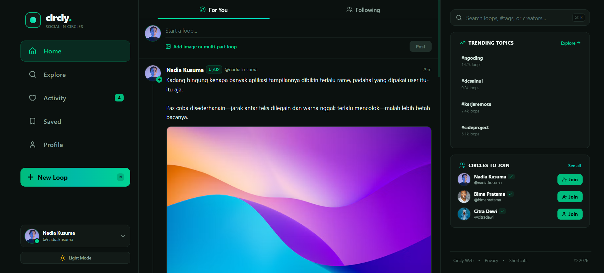

# circly.

A Threads-inspired social microblogging web application built with React 19, TypeScript, Tailwind CSS v4, Hono, and Turso (libSQL).



## Features

- **Home Feed & Chained Loops**: Browse `For You` and `Following` feeds, compose single posts or multi-part chained loops, and reply in nested thread conversations.
- **Social Graph & Engagement**: Like posts and replies, repost (re-loop), bookmark posts, follow/unfollow users, and inspect `Followers`, `Following`, and `Mutuals`.
- **Explore & Activity**: Search posts, hashtags, and creators, browse trending topics, and view activity notifications.
- **Persona Switcher & Theme**: Switch between seeded user personas from the sidebar and toggle between Dark and Light themes.
- **Turso Persistence**: Server-side Hono API backed by Turso (`@libsql/client`) keeps database credentials out of the browser bundle while syncing posts, replies, likes, reposts, bookmarks, and follows.

## Tech Stack

- **Frontend**: React 19, TypeScript, Vite, Tailwind CSS v4, Zustand, Framer Motion, Lucide React
- **Backend & Database**: Hono (`@hono/node-server`), Turso (`@libsql/client`)

## Getting Started

1. **Install dependencies**

   ```bash
   pnpm install
   ```

2. **Configure environment variables**

   Copy `.env.example` to `.env.local` and set your Turso credentials:

   ```env
   TURSO_DATABASE_URL=libsql://your-db-name.turso.io
   TURSO_AUTH_TOKEN=your-turso-auth-token
   ```

3. **Run database migration and seed**

   ```bash
   pnpm run db:migrate
   pnpm run db:seed
   ```

4. **Start the development servers**

   ```bash
   pnpm dev
   ```

   This starts the Hono API server (`http://localhost:3001`) and the Vite frontend (`http://localhost:5173`) with `/api` proxying enabled.

## Available Scripts

- `pnpm dev` — Run both API and web dev servers concurrently
- `pnpm run dev:api` — Run the Hono API server with `tsx watch`
- `pnpm run dev:web` — Run the Vite dev server
- `pnpm run build` — Build the production frontend bundle into `dist/`
- `pnpm run db:migrate` — Apply `db/schema.sql` to Turso
- `pnpm run db:seed` — Seed initial users, posts, follows, and activities
